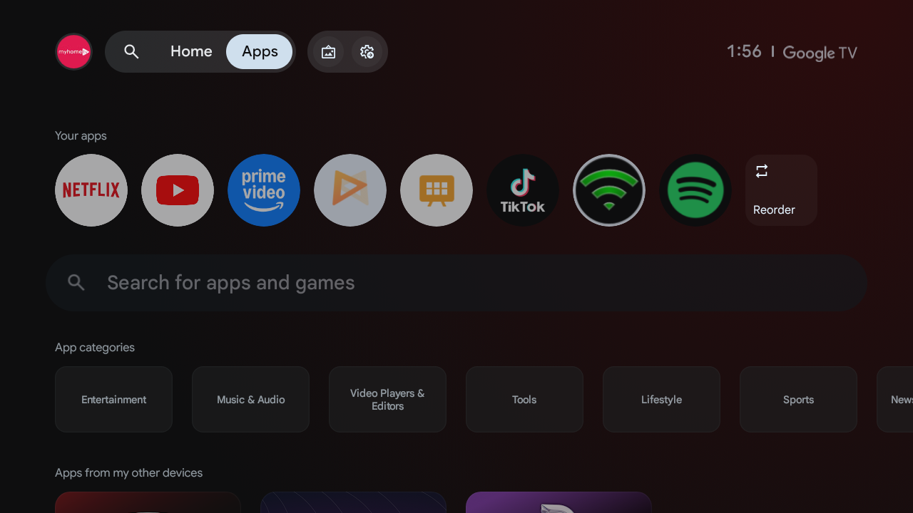
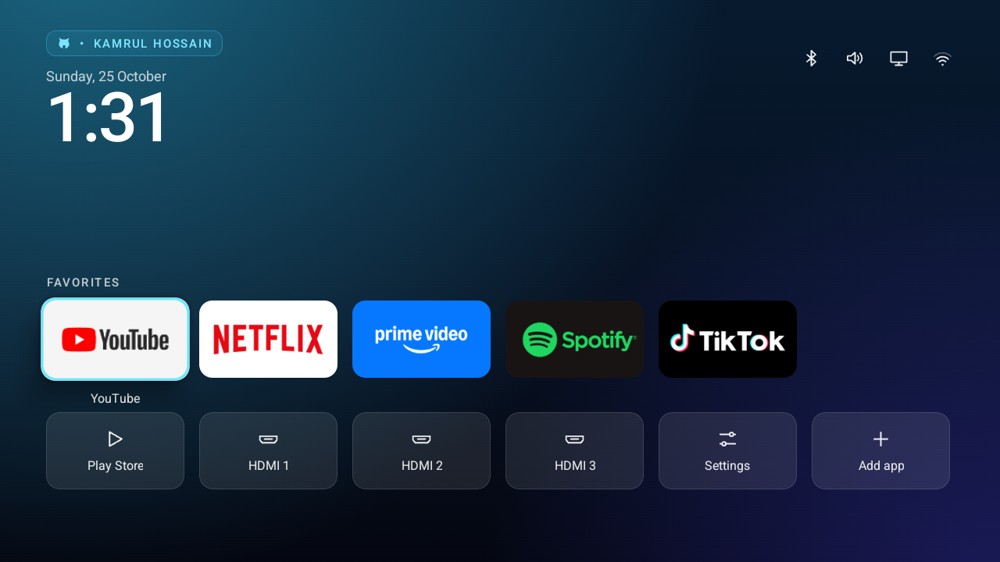
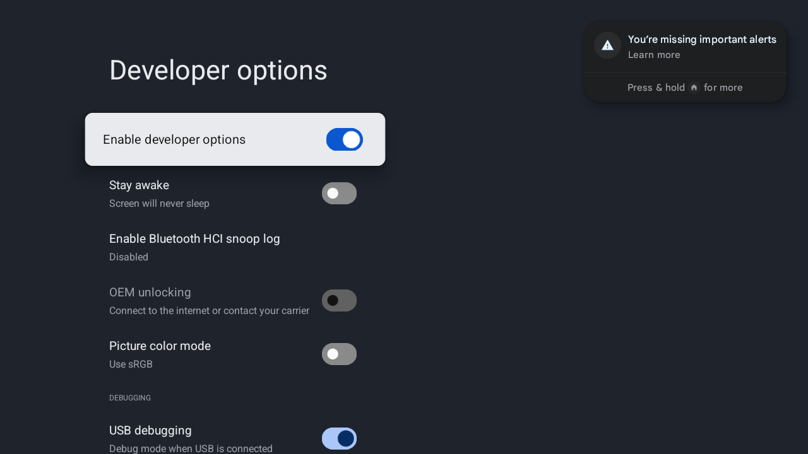
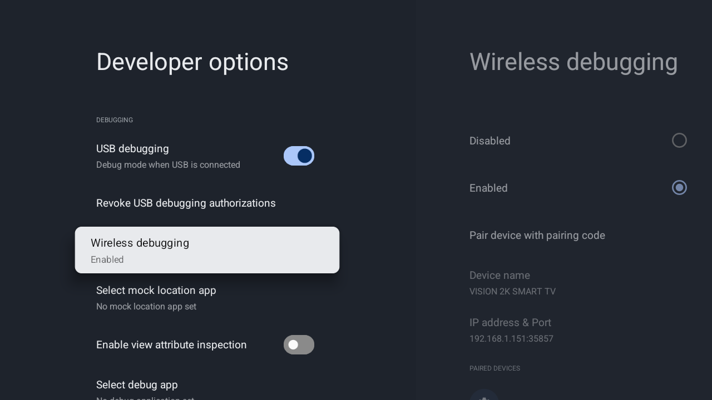

<div align="center">

# CleanYourTV

### A fast, calm, personalized launcher and reversible cleanup workflow for Android TV

**Built and maintained by [Kamrul Hossain](https://github.com/kamrullab)**

[](#)
[](LICENSE)
[](AUTOMATION_PROMPT.md)
[](https://github.com/kamrullab/CleanYourTV)

<p>
  <a href="#3-paste-this-in"></a>
  <a href="#before-and-after"></a>
  <a href="#manual-commands"></a>
</p>

</div>

## Before and after

### Before: stock Google TV



### After: CleanYourTV



The stock launcher contains recommendations, sponsored content, and firmware-controlled Home routing. CleanYourTV provides a lightweight app row, HDMI shortcuts, settings, clock, network status, and a personalized **GitHub icon • KAMRUL HOSSAIN** header.

## Why CleanYourTV

- **⚡ Fast** - Lightweight launcher, disabled animations, measured cold/hot starts, and settings tuned for low-RAM TVs.
- **🧹 Clean** - Reversible cleanup of selected bloat, demos, telemetry, and removable promotional components.
- **🛡️ Safe** - Never deletes system apps. Every change is logged, checked, and recoverable with an undo script.
- **🤖 Automatic** - One detailed prompt handles ADB setup, connection, package review, build, install, and verification.
- **🎨 Personal** - Custom GitHub header, favorite apps, HDMI shortcuts, settings, network state, date, and clock.
- **↩️ Reversible** - Original values and disabled packages are saved before changes. Run `undo.sh` to restore them.

## Automatic workflow

<div align="center">


</div>

> [!TIP]
> **No terminal knowledge is required.** Paste the prompt into a local AI agent and respond only when Android needs a physical approval, pairing code, or safety decision.

## No coding needed

You only need:

1. An Android TV and computer on the same Wi-Fi.
2. A local computer agent such as Codex or Claude Code.
3. Developer Options and Wireless/Network debugging enabled on the TV.
4. The copy-and-paste prompt below.

The agent handles the PC folder, official ADB download, TV connection, package review, reversible cleanup, launcher build/install, verification, screenshots, undo files, and reports. Android may still require you to accept **Allow debugging**, provide a Wireless Debugging pairing code, answer whether the panel is OLED, or approve a high-risk launcher override.

## Quick start

<div align="center">


</div>

- **📺 On the TV:** Enable Developer Options and debugging. Accept Android's pairing or authorization message if shown.
- **💻 On the computer:** Open Codex or another local agent, paste the prompt, and let it download ADB and perform the workflow.

### 1. Enable debugging

On the TV, open **Settings → Device Preferences/System → About**, press **Build** seven times, then enable **USB debugging** and **Wireless/Network debugging** in Developer Options.

#### USB debugging



#### Wireless debugging



> [!NOTE]
> Look for the blue **Enable developer options** and **USB debugging** switches. Scroll farther down to confirm **Wireless debugging - Enabled**. Some brands call it **Network debugging** or open a separate page with pairing and connection ports.

### 2. Open a local AI agent

Open Codex, Claude Code, or another agent that can run commands on your computer. A web-only chatbot cannot access devices on your home network.

<p align="center">
  <a href="#3-paste-this-in"></a>
</p>

### 3. Paste this in

Copy the entire prompt below. After one risk confirmation, the agent proceeds automatically through ordinary reversible steps.

```text
Clean up, speed up, and install a lightweight personalized home screen on my Android/Google TV.

I am a nontechnical user. Do not expect me to know code, ADB, package names, Git, Java, terminal commands, or folder setup. Automatically clone/download `https://github.com/kamrullab/CleanYourTV`, prepare everything it needs in a dedicated PC folder, and apply that project as my TV launcher. Give me only short instructions for taps or codes that physically require me.

Before changing anything, explain this warning in plain words: this process turns off some system apps and carries risk. A few TVs have become stuck at the startup logo or kept restarting, and an AI can make mistakes. Explain that `undo.sh` plus the saved undo list restores every package and setting changed by this workflow. Ask me once to reply `I confirm, proceed` before making TV changes.

After that single confirmation, work autonomously from start to finish. Do not ask for approval before every ordinary reversible change. The single confirmation authorizes read-only checks, creating a dedicated project folder on my PC, downloading official Android Platform Tools, reversible Android settings changes, disabling only conservatively classified nonessential packages, building/installing the custom launcher, taking screenshots, restarting the TV once, and producing undo scripts and reports.

Pause only when I must physically act or provide information: an Android RSA/pairing code dialog, an operating-system permission prompt, credentials, an unknown TV IP that cannot be discovered safely, an OLED/non-OLED answer, or the separate high-risk launcher override described below. Never claim those prompts can be bypassed.

Before applying the confirmed changes, show me the complete plain-English package classification, baseline free memory/storage, and the exact proposed SAFE NONESSENTIAL disable list. This is a report, not another approval checkpoint. Then continue automatically under my one-time confirmation.

Safety rules:
1. Never delete system packages. Use `pm disable-user --user 0` only. Save every newly disabled package before changing it and generate a tested `undo.sh`/`undo.ps1` that re-enables it.
2. Never disable Google Play services (`com.google.android.gms`), Google Services Framework, Play Store, Settings, System UI, setup/provisioning, package installer, permission controller, keyboard/IME, Bluetooth, Wi-Fi/network stack, remote-control services, HDMI/input/tuner/Live TV frameworks, audio framework, WebView when required, or persistent/unknown vendor components. When unsure, leave it enabled.
3. Keep screensaver enabled unless I explicitly confirm the panel is not OLED. Do not infer OLED status only from a marketing/model name.
4. Do not disable `com.google.android.apps.tv.launcherx` automatically. First install and verify the custom launcher while launcherx remains enabled. If firmware keeps taking Home back, explain the boot-loop/factory-reset risk and require the exact confirmation `Disable launcherx; I accept the risk.` before disabling it.
5. Keep a timestamped change log containing original values, commands, results, and exact undo commands. Preserve existing user files and Git history.
6. Download executables only from official sources. Do not weaken firewalls or Android security settings.

Automatic workflow:
1. Create a dedicated folder named `CleanYourTV` in the current workspace or another user-approved writable directory. Record the absolute path.
2. Detect Windows/macOS/Linux and check for `adb`, Git, Bash/PowerShell, Java 17, and Android build tools. If ADB is missing, download official Android Platform Tools from Google into the dedicated folder and verify that `adb version` works. Do not install unrelated software globally when a local portable tool works.
3. Determine the TV IP from the value I provide. If absent, inspect the local subnet and ARP/neighbor table conservatively, identify likely Android TV devices through ping and standard discovery, and show the candidate before making an ADB connection. Do not scan public networks.
4. Ping the TV and report latency/loss. Probe only standard TV/ADB ports. Try `adb connect TV_IP:5555`. For modern Wireless Debugging, walk me through `Pair device with pairing code`, run `adb pair IP:PAIRING_PORT`, then connect to the separate debugging port. If the TV displays `Allow debugging?`, tell me to select `Always allow` and `Allow`, then continue automatically.
5. Verify `adb get-state=device`. Read manufacturer, brand, model, Android/API/security patch, build, CPU ABI, hardware, RAM, storage, uptime, thermal state, current Home handler, default IME, installed/disabled packages, and user-installed apps. Do not expose the serial number publicly.
6. Measure a baseline: available memory, swap, storage, app-cache total, CPU idle/load, temperature, cold/hot launcher times when applicable, and current animation/sleep/screensaver settings. Save the baseline report.
7. Inventory every package. Produce a plain-English table with categories: REQUIRED/NEVER DISABLE, FEATURE/KEEP UNLESS UNUSED, SAFE NONESSENTIAL, USER APP, and UNKNOWN/LEAVE ON. Explicitly list the package name, enabled state, reason, and proposed action. Continue automatically only with SAFE NONESSENTIAL packages. Leave FEATURE and UNKNOWN packages on unless I explicitly named the feature as unwanted.
8. Before each disable, append the package to `/data/local/tmp/cleanyourtv-disabled.txt` and the local change log. Disable, verify it appears in `pm list packages -d`, and restore immediately if verification or a required service check fails.
9. Turn animation scales off. Set sleep timeout to five minutes. Keep screensaver enabled. Save and document the original values for undo.
10. Clone or update `https://github.com/kamrullab/CleanYourTV` into the dedicated PC folder. Preserve its Git history and attribution. Do not overwrite unrelated local changes.
11. Detect launchable user apps and configure the launcher row automatically. Prefer the apps the user actually installed. Keep HDMI inputs, Settings, network status, Play Store, and an Add App control.
12. Personalize the header as `GitHub icon • KAMRUL HOSSAIN` unless I provide another name. Build from source with Java 17/Android SDK or use the repository's successful GitHub Actions artifact. Use stable signing credentials for updates; never commit a private signing key or secret.
13. Install/update `com.kamrullab.cleanyourtv`, set it as the Android Home role, open it, and verify foreground focus. Take a real TV screenshot, inspect it visually, and update `docs/home-screen.png` plus the README preview.
14. Press Home and verify routing. If the stock Google TV launcher wins, leave it enabled and report the firmware priority conflict. Only follow the launcherx high-risk path after the exact separate confirmation required above. If that confirmation is given, save launcherx in the undo list, disable it, verify custom Home immediately, wait 30 seconds, restart once, and automatically restore launcherx if Home/boot verification fails while ADB remains available.
15. Wait at least 30 seconds after the last TV change, restart the TV once, reconnect ADB, wait for `sys.boot_completed=1`, and verify model, Home, HDMI/input framework, Settings, keyboard, Bluetooth, Wi-Fi, Play services, disabled list, animation/sleep/screensaver values, memory, storage, temperature, and recent crash/ANR logs.
16. Benchmark the custom launcher with at least two cold starts and one hot start. Report launch times and PSS memory. Treat tiny gfxinfo samples as inconclusive rather than claiming 100% jank.
17. Clear app caches only if they are materially large and only with Android-supported cache-trim commands; never clear app data, logins, media, or downloads. Do not delete the undo list. Report space before and after.
18. Generate `PACKAGE_REVIEW.md`, `CLEANUP_LOG.md`, `undo.sh`, and Windows-friendly undo instructions. Test shell syntax and verify the repository is clean except for intended changes.
19. If GitHub credentials and the intended repository are already available, commit and push the source, reports, and verified screenshot. Never print tokens or secrets. Otherwise stop with exact push commands instead of requesting credentials in chat.
20. Finish with a concise before/after table, disabled-package list, benchmark results, remaining limitations, undo command, repository/commit link, and a reminder to turn off USB/Network/Wireless debugging or Developer Options.

My TV IP (optional): <TV_IP>
My preferred apps (optional): <APP_NAMES_OR_AUTO>
My display name: KAMRUL HOSSAIN
My repository: https://github.com/kamrullab/CleanYourTV
```

### 4. Turn debugging off afterward

After verification, disable USB, Network, and Wireless debugging-or disable Developer Options completely. Turn it on again only when running updates or `undo.sh`.

Your finished launcher should look like this:


<div align="center">


</div>

## Safety model

CleanYourTV never automatically disables Google Play services, Play Store, Settings, System UI, setup/provisioning, keyboard, Bluetooth, Wi-Fi/network stack, HDMI/input/tuner frameworks, or unknown persistent vendor services.

Google TV firmware can force `com.google.android.apps.tv.launcherx` even when Android assigns CleanYourTV the Home role. Disabling that protected launcher or its setup fallback can cause restart loops on some TVs. The automatic workflow requires a separate explicit risk confirmation before attempting that path.

## What gets created

- `PACKAGE_REVIEW.md` - every package with a plain-English classification.
- `CLEANUP_LOG.md` - before/after memory, storage, settings, and verification results.
- `undo.sh` - restores disabled packages, original settings, and the stock launcher.
- `docs/home-screen.png` - screenshot from the verified TV.

## Manual commands

Install or update the launcher:

```sh
sh install.sh <TV_IP> "com.google.android.youtube.tv,com.netflix.ninja,com.amazon.amazonvideo.livingroom,com.spotify.tv.android,com.tiktok.tv" "bluetooth,sound,picture"
```

Inspect packages without changing anything:

```sh
sh candidates.sh <TV_IP>
```

Undo the complete cleanup:

```sh
sh undo.sh <TV_IP>
```

## TV used for the verified screenshots

| Detail | Value |
|---|---|
| Brand/model | VISION 2K SMART TV |
| Android | 14 / API 34 |
| Hardware | MediaTek MT5867, ARM 32-bit |
| RAM | Approximately 1.4 GB |
| Launcher package | `com.kamrullab.cleanyourtv` |

## License

MIT. See [LICENSE](LICENSE) for copyright and required notices.

---

<div align="center">

Made for a cleaner TV experience by **Kamrul Hossain**.

</div>
